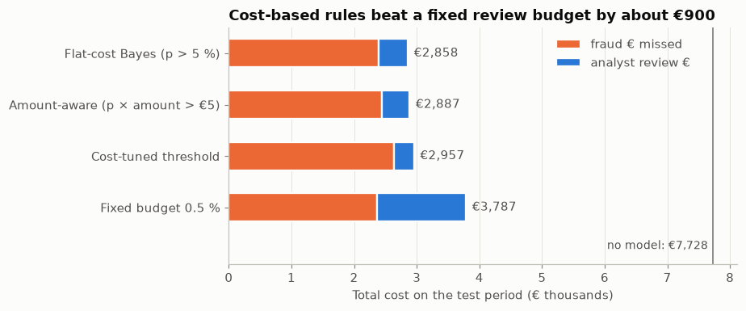
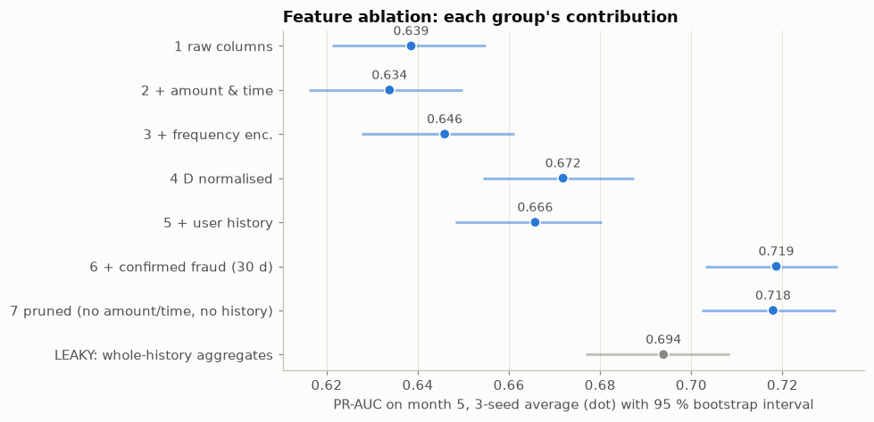
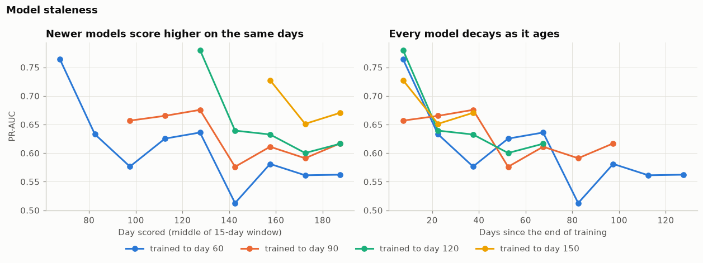
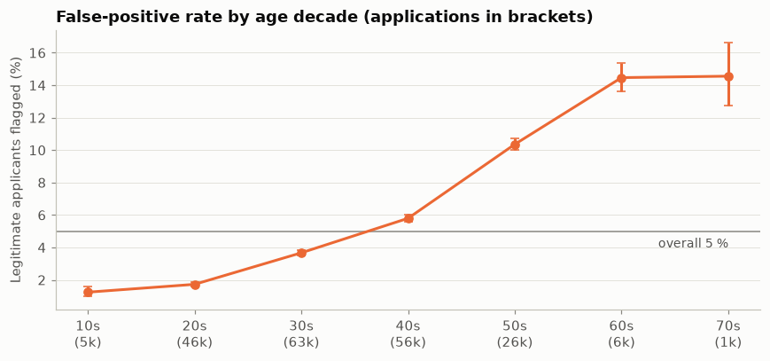

# Fraud Detection Portfolio

Machine-learning projects on three public fraud datasets. Each one tackles a problem fraud
teams face in practice: extreme class imbalance, feature engineering on behavioural data,
models going stale, and fair treatment of customers. Every project is a set of executed,
commented notebooks that explain the concepts, the strategies tried and the evidence behind
each decision, including the ideas that didn't work.

| # | Project | Dataset | Headline result |
|---|---|---|---|
| 1 | [Credit card fraud](projects/01_ulb_creditcard/) | ULB Credit Card Fraud (284k transactions, 0.17 % fraud) | 85 % of fraud caught when 0.5 % of transactions are reviewed; cost-based decision rules ~24 % cheaper than a fixed review budget |
| 2 | [E-commerce fraud](projects/02_ieee_cis/) | IEEE-CIS / Vesta (590k transactions, 434 columns) | Feature engineering lifts PR-AUC from 0.64 to 0.72; one month of staleness costs about as much as all the features gained |
| 3 | [Account-opening fraud](projects/03_bank_account_fraud/) | Bank Account Fraud, Feedzai (1M applications) | 54.5 % of fraud caught at 5 % false-positive rate; a fairness audit finds older legitimate applicants flagged 3× as often, and quantifies the fixes |

Planned next: graph-based anti-money-laundering on the Elliptic Bitcoin dataset.

## Highlights

### Choosing the decision rule is worth as much as choosing the model
*Project 1.* The same calibrated model under five decision rules. Thresholds derived from
the cost of a missed fraud versus an analyst review beat a fixed review budget by about
€900 on the test period. The notebook also shows why the "optimal" amount-aware rule is
only optimal under a naive cost model.



### Feature engineering, tested one hypothesis at a time
*Project 2.* Each feature group is added in turn, trained with 3 random seeds, and its gain
tested with a paired bootstrap. Reconstructing a user ID and counting the user's
*already-confirmed* frauds (respecting a 30-day label delay) gave the largest gain. Two
sensible-looking groups turned out to be redundant, and whole-history aggregates (grey) are
shown to be leakage.



### Models go stale within weeks
*Project 2.* Models trained up to different days, then frozen. Each is best in its first two
weeks and loses 0.08–0.14 PR-AUC within a month; on any given day the newest model wins.
Retraining with one extra month was worth +0.07 PR-AUC on the test month.



### Accurate on average, unequal across ages
*Project 3.* At a single threshold flagging 5 % of legitimate applicants overall,
legitimate applicants in their 60s are wrongly flagged about 14 % of the time, against under
2 % in their 20s. Removing the age column barely helps (other features predict age with
AUC 0.84). Group-specific thresholds reach parity at a cost of 2.6 points of recall.



## What the projects demonstrate

| Topic | Where |
|---|---|
| Metrics for rare events (PR-AUC, recall at a review budget, recall at fixed FPR) with bootstrap intervals | all projects |
| Class imbalance: weighting, undersampling, SMOTE, and their effect on calibration | [1 · 02](projects/01_ulb_creditcard/02_imbalance_strategies.ipynb) |
| Anomaly detection vs. supervised learning, label efficiency | [1 · 03](projects/01_ulb_creditcard/03_anomaly_detection.ipynb) |
| Calibration, cost-based thresholds, SHAP explanations | [1 · 04](projects/01_ulb_creditcard/04_threshold_cost_explainability.ipynb) |
| Time-based validation, adversarial validation, drift | [2 · 01](projects/02_ieee_cis/01_eda.ipynb), [3 · 01](projects/03_bank_account_fraud/01_eda.ipynb) |
| Causal feature engineering, label delay, leakage | [2 · 02](projects/02_ieee_cis/02_feature_engineering.ipynb) |
| LightGBM vs. XGBoost vs. CatBoost, blending, retraining cadence | [2 · 03](projects/02_ieee_cis/03_models_and_validation.ipynb) |
| Operating at a fixed false-positive rate, threshold drift | [3 · 02](projects/03_bank_account_fraud/02_model_at_fixed_fpr.ipynb) |
| Fairness audit, proxies, mitigation and its cost | [3 · 03](projects/03_bank_account_fraud/03_fairness.ipynb) |

## Repository layout

```
projects/          one folder per project: notebooks + README with results
src/fraudkit/      shared, tested code
  data.py          dataset download and memory-lean loading
  metrics.py       fraud metrics, bootstrap and paired-bootstrap intervals
  fairness.py      operating-point and group-fairness metrics
  ieee.py, baf.py  project-specific feature pipelines
  plotting.py      shared chart style (colour-blind-safe palette)
tests/             unit tests for fraudkit
```

## Setup

```bash
uv sync                       # Python 3.12 environment from uv.lock
export KAGGLE_API_TOKEN=...   # used to download the datasets
uv run pytest                 # shared-code tests
uv run jupyter lab            # open the notebooks
```

Each project downloads its own data into `data/raw/` on first run (not committed). Project
2 also requires accepting the [IEEE-CIS competition rules](https://www.kaggle.com/c/ieee-fraud-detection)
on Kaggle. Everything runs on a CPU; the notebooks were executed on a 16-core machine with
under 8 GB of RAM available.
